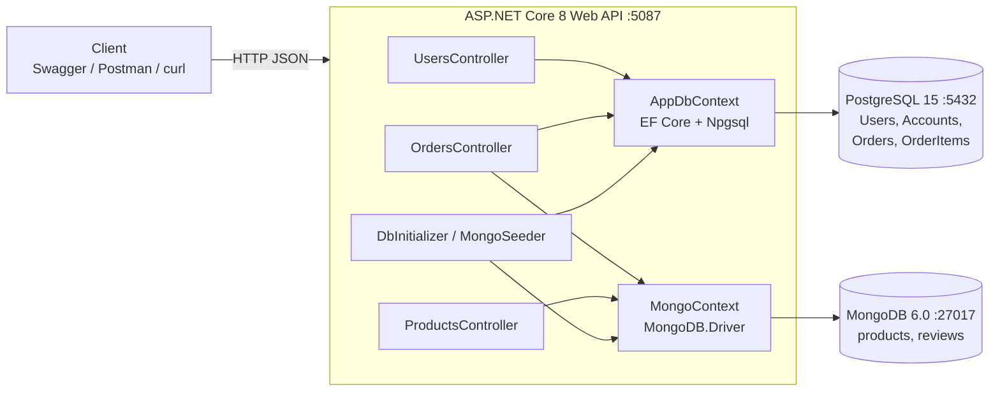
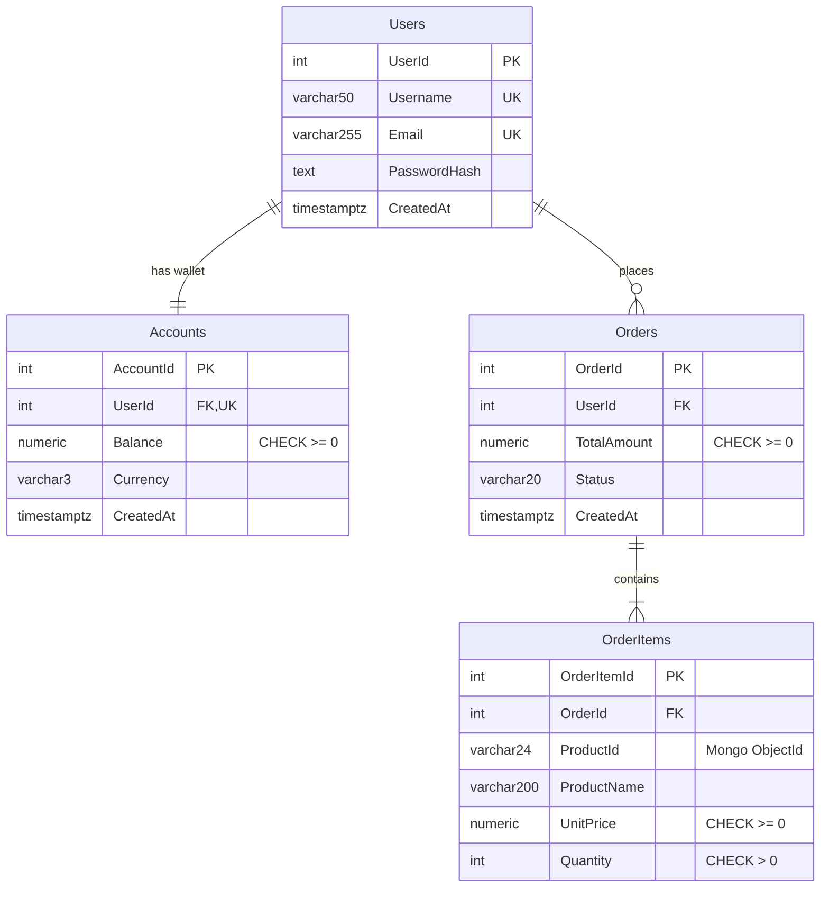
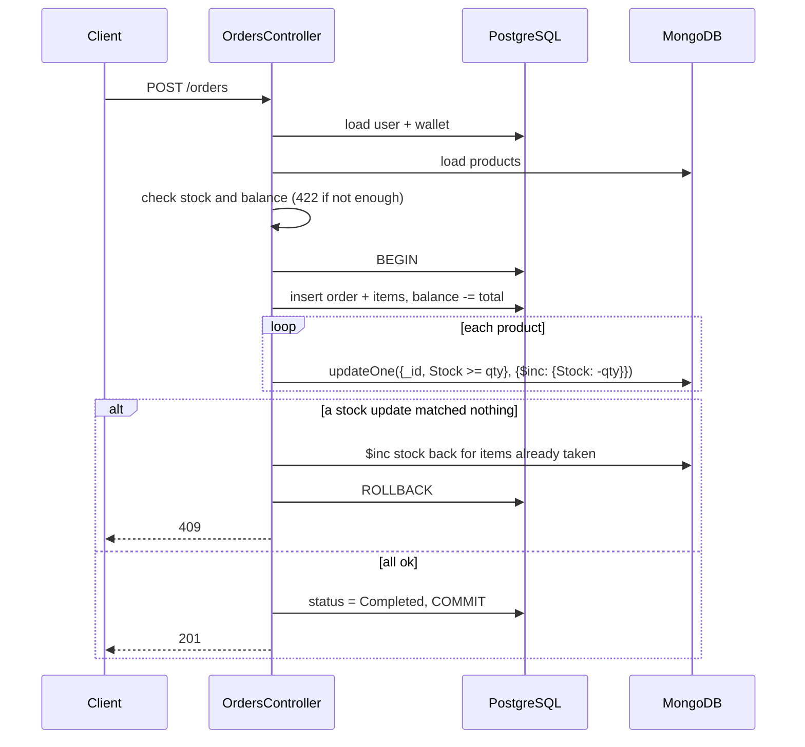

# GAMIQ - Game Marketplace API

269340 Data Centric Application Development (2026) - Team Project Checkpoint 1 + 2 + 3

GAMIQ is our backend for a small online game store (kind of like a mini Steam). Users have a
wallet in THB, they can browse games and buy them. We used ASP.NET Core 8 Web API with
PostgreSQL (EF Core) and MongoDB.

Checkpoint 1 (the API and both databases) is the first part of this README. Checkpoint 2 (the
zero-downtime schema migration) starts at [CP2: Zero-downtime schema migration](#cp2-zero-downtime-schema-migration).
Checkpoint 3 (concurrency and performance) starts at [CP3: Concurrency control and performance audit](#cp3-concurrency-control-and-performance-audit).

## Team

| Student ID | Name | CP1 part | CP2 part | CP3 part |
|---|---|---|---|---|
| 670615021 | Yanisa Khankhumnanta | PostgreSQL | Phase 3 backfill job, backfill verification queries, traffic generator | |
| 670615023 | Natthawan Saengsrichan | Docker + MongoDB | Phase 4 switch read, phase 5 contract, fallback video | |
| 670615028 | Pitikan Kanjanasiri | API endpoints | Migration phase switch, phase 1 expand, phase 2 dual write | Concurrency control (wallet top-up with OCC, `If-Match` / 412), `tools/test_concurrency.py` |

### Who did what (CP1)

**Natthawan** set up the repo and `docker-compose.yml` (Postgres + Mongo with volumes and
healthchecks), `.env.example`, `.gitignore` and the empty .NET project. Natthawan also did the MongoDB
side: the `Product` and `Review` models, `MongoContext` with the indexes, and `MongoSeeder`
(1,200 games, 2,000 reviews).

**Yanisa** designed the PostgreSQL tables (`Users`, `Accounts`, `Orders`, `OrderItems`) in
`AppDbContext`, including the keys, indexes and check constraints. Yanisa also made the EF Core migration,
exported it to `db/postgres/001_init.sql`, and wrote `DbInitializer` to seed 1,000 users with
wallets and 500 old orders.

**Pitikan** wrote the controllers and DTOs (users, products, orders), the validation, and the
order logic that writes to both databases, plus `GAMIQ.Api.http` and most of this README.

We tested everything together at the end with Swagger and the `.http` file.

## How to run

You need Docker Desktop and the .NET 8 SDK. Make sure nothing else is using ports 5432, 27017
or 5087.

```bash
cp .env.example .env        # default values already match docker-compose
docker compose up -d
docker compose ps           # wait until both say "healthy"

cd src/GAMIQ.Api
dotnet run
```

Then open http://localhost:5087/swagger. You can also use `src/GAMIQ.Api/GAMIQ.Api.http`, which
has a request for every endpoint.

The first run takes a few seconds longer because it creates the tables and seeds both databases.
After that it sees the data is already there and skips seeding. If you want to reset everything:

```bash
docker compose down -v
docker compose up -d
```

## Architecture



Both databases run in Docker with their own named volume, so the data survives a restart.
The `db/postgres` folder is mounted to `/docker-entrypoint-initdb.d`, so Postgres runs our
`001_init.sql` the first time it starts.

## Why we split the data like this

Our rule was simple: anything to do with money goes in PostgreSQL. Wallet balances and orders have
to be correct, so we wanted foreign keys, constraints and real transactions there.

Games are different. A VR game needs a list of headsets, a multiplayer game has max players, and a
PC game has minimum specs. Making a SQL column for every possible field would leave most of them
NULL, so the catalog went into MongoDB. Reviews also went into Mongo because there are a lot of
them and each one can carry different extra info.

## PostgreSQL schema



Some notes on the design:

- Username and email are unique. `Accounts.UserId` is unique too, so each user can only have one wallet.
- Balance can't go negative, and quantity has to be more than 0. These are enforced with CHECK constraints, not only in C#.
- You can't delete a user who has orders (`RESTRICT`). Deleting an order deletes its items (`CASCADE`).
- `OrderItems` keeps its own copy of the product name and price. If a game's price changes later in Mongo, old orders still show what the customer actually paid.
- `Accounts` uses Postgres `xmin` as a row version. If two orders try to change the same wallet at the same time, one of them gets a 409 instead of silently overwriting the other.
- We added indexes on `Orders(UserId, CreatedAt)`, `OrderItems.OrderId` and `OrderItems.ProductId`.

The schema is in the EF migration (`src/GAMIQ.Api/Migrations`) and also as plain SQL in
`db/postgres/001_init.sql`.

## MongoDB collections

`products`: every game has the same basic fields, but `Attributes` changes from game to game.
For example:

```js
{
  "_id": ObjectId("..."),
  "Name": "Neon Requiem: Part II",
  "Description": "Uncover the history of a forgotten kingdom. New maps and modes are added every season.",
  "Price": NumberDecimal("590"),
  "Stock": 197,
  "Genres": ["Simulation", "Adventure"],
  "Platforms": ["Windows", "NintendoSwitch"],
  "Tags": ["VR Supported", "Co-op"],
  "Attributes": {
    "developer": "Pfannerstill and Sons",
    "publisher": "Paucek Group",
    "releaseYear": 2020,
    "ageRating": "T",
    "languages": ["Korean", "German"],
    "maxPlayers": 4,
    "vrHeadsets": ["Meta Quest 3"],
    "estimatedHours": 45,
    "minSpecs": { "os": "Windows 10 64-bit", "ramGb": 8, "storageGb": 60, "gpu": "GTX 1660" }
  },
  "CreatedAt": ISODate("...")
}
```

`reviews`: a rating and comment, plus a `Metadata` object with whatever the client sends
(platform, patch version, and so on). PC reviews also have `avgFps`.

```js
{
  "_id": ObjectId("..."),
  "ProductId": ObjectId("..."),
  "UserId": 900,
  "Rating": 3,
  "Comment": "Fun at first but gets repetitive after a few hours.",
  "PlaytimeHours": 291.9,
  "Metadata": { "platform": "Linux", "patchVersion": "3.10.7", "verifiedPurchase": true, "avgFps": 117 },
  "CreatedAt": ISODate("...")
}
```

The indexes are created when the app starts (`MongoContext.EnsureIndexesAsync`):

- `products`: `CreatedAt`, `Genres`, and a text index on `Name`
- `reviews`: `ProductId + CreatedAt`, and `UserId`

`reviews.UserId` points to a Postgres user and `OrderItems.ProductId` points to a Mongo product.
There's no foreign key across two databases, so the API checks these itself.

## API

Base URL: `http://localhost:5087/api/v1`

| Method | Route | Description | DB |
|---|---|---|---|
| POST | `/users` | create a user (also creates a wallet with 0 THB) | PostgreSQL |
| GET | `/users/{id}` | get a user and their balance (`ETag` header = wallet version) | PostgreSQL |
| POST | `/users/{id}/wallet/topup` | add money to the wallet, optional `If-Match` (CP3) | PostgreSQL |
| GET | `/products?page=1&pageSize=20` | catalog with paging, `&genre=RPG` is optional | MongoDB |
| GET | `/products/{id}` | get one game | MongoDB |
| POST | `/products` | add a game, `attributes` can be any JSON | MongoDB |
| POST | `/orders` | buy games (pay from wallet + cut stock) | PostgreSQL + MongoDB |
| GET | `/orders/{id}` | get an order with its items | PostgreSQL |

Status codes we return:

- `200` OK, `201` Created (with a `Location` header)
- `400` for bad input: missing fields, bad email, quantity 0, invalid ObjectId, broken JSON
- `404` when the user, product or order doesn't exist
- `409` when the username or email is already taken, or the stock or wallet changed while ordering
  or topping up
- `412` when a top-up sends `If-Match` and the wallet was changed since that version was read
- `422` when there isn't enough stock or money

## How an order works

This was the hardest part, because one order has to update both databases.



Postgres and Mongo can't be in the same transaction. So we open a Postgres transaction, then
reduce stock in Mongo one product at a time. The Mongo update only matches if `Stock >= qty`,
so two people buying the last copy at the same time can't push stock below 0. If any product
fails, we put back the stock we already took and roll back Postgres.

We tested this by sending 10 orders at once for a game with only 3 left. Exactly 3 went through
and stock ended at 0.

One thing we know isn't perfect: if Mongo goes down right in the middle of an order, putting the
stock back could also fail. We think the proper fix is an outbox table or a saga with retries,
but we left that out of CP1.

## Seed data

Seeding runs automatically on startup (`Data/DbInitializer.cs` for Postgres and
`Data/Mongo/MongoSeeder.cs` for Mongo). We used the Bogus library with a fixed seed of 42, so
everyone gets the same data.

- Postgres: 1,000 users, 1,000 wallets, 500 orders and about 990 order items
- Mongo: 1,200 games and 2,000 reviews

Game prices use normal Thai store prices (99, 199, 590, 1,290 THB and so on), and wallets start
with 0 to 5,000 THB. Every seeded user's password is `Passw0rd!`. It's stored as a hash
(ASP.NET Identity `PasswordHasher`), never as plain text.

## Config / secrets

There are no passwords in `appsettings.json`. Connection strings come from `.env`, which is
in `.gitignore`, so only `.env.example` is in git. `Config/DotEnv.cs` loads the file when the app
starts. If you forget to create `.env`, the app stops right away and tells you to copy
`.env.example`.

## CP2: Zero-downtime schema migration

**Scenario.** `Orders.TotalAmount` is one number and the currency is not stored anywhere, we just
assumed THB. To sell in other currencies later we replace it with two columns,
`Orders.PriceAmount` + `Orders.CurrencyCode`, using expand-contract, while the API keeps taking
orders.

| # | Phase | What happens | Status |
|---|---|---|---|
| 1 | Expand | `db/postgres/cp2/01_expand.sql` adds the two new columns next to `TotalAmount` | done |
| 2 | Dual write | `POST /orders` writes `TotalAmount` and `PriceAmount` + `CurrencyCode` | done |
| 3 | Backfill | `Jobs/BackfillJob.cs` copies `TotalAmount` into the new columns for old orders, in batches with a checkpoint | done |
| 4 | Switch read | `GET /orders/{id}` answers from `PriceAmount` + `CurrencyCode` | done |
| 5 | Contract | `02_contract_prepare.sql`, switch the API to `Contract`, `03_contract.sql` drops `TotalAmount` | done |

Also done: the traffic generator (`tools/traffic_gen.py`), a verification script for every phase
(`db/postgres/cp2/verify_*.sql`) and `tools/run_migration.sh`, which runs all five phases in
order.

**Fallback video** (the whole migration, phase 1 to 5, with the traffic generator running):
https://drive.google.com/drive/folders/1O59ZmltvAdgc6Gv3BWWPftaBDFI6Zc-B?usp=sharing
The recording is played at 1.25x so it fits in 3 minutes. The seconds printed by the traffic
generator are the real time of the run.

The whole migration in one go, on a fresh database with the API in `Legacy`:

```bash
docker exec gamiq_postgres psql -U dev_user -d main_db -f /docker-entrypoint-initdb.d/cp2/demo_topup_wallets.sql
python3 tools/traffic_gen.py --seconds 0     # terminal 2, leave it running
./tools/run_migration.sh                     # terminal 3, press Enter for every step
```

Every step of that script is explained below.

### How the API changes phase without a restart

Restarting the API in the middle of the migration would already be downtime, so the phase is a
runtime setting (`Config/MigrationState.cs`). It starts from `Migration:Phase` in
`appsettings.json` (default `Legacy`) and is changed with one request:

```bash
curl -X PUT http://localhost:5087/api/v1/migration/phase -H "Content-Type: application/json" -d '{"phase":"DualWrite"}'
curl http://localhost:5087/api/v1/migration/phase
```

The phases are `Legacy`, `DualWrite`, `ReadNew`, `Contract`.

Switching too early would not fail at the switch, it would fail on the next order with a 5xx. So
the `PUT` first asks `Data/MigrationGuard.cs` if the database is ready, and answers `409` with
the missing step if it is not:

| Switch to | The database must have |
|---|---|
| `DualWrite` | the new columns (`01_expand.sql`) |
| `ReadNew` | no order with an empty `PriceAmount` / `CurrencyCode` (backfill finished) |
| `Contract` | the same, and `TotalAmount` nullable (`02_contract_prepare.sql`) |
| anything else, after the drop | not possible, `TotalAmount` is gone |

The phase lives in the memory of the API process and starts from `appsettings.json` again after a
restart. The one case where that would break things is a restart after `TotalAmount` was dropped
(`Legacy` would ask for a column that is gone), so at startup the API looks at the table and
starts in `Contract` by itself when the column does not exist anymore.

EF Core puts every mapped column in its SELECT and INSERT, so it would crash on a column that
isn't there yet (before expand) or is already gone (after contract). `AppDbContext` therefore maps
`Orders` differently per phase, and `PhaseModelCacheKeyFactory` makes EF keep one model per phase:

| Phase | `TotalAmount` | `PriceAmount`, `CurrencyCode` |
|---|---|---|
| Legacy | mapped | ignored |
| DualWrite | mapped | mapped |
| ReadNew | mapped, may be `NULL` when loaded | mapped |
| Contract | ignored | mapped |

### Running phase 1 and 2

Start the API as usual (it is in `Legacy`), then with traffic running:

```bash
# Phase 1 - expand
docker exec gamiq_postgres psql -U dev_user -d main_db -v ON_ERROR_STOP=1 -f /docker-entrypoint-initdb.d/cp2/01_expand.sql

# Phase 2 - dual write
curl -X PUT http://localhost:5087/api/v1/migration/phase -H "Content-Type: application/json" -d '{"phase":"DualWrite"}'

# check
docker exec gamiq_postgres psql -U dev_user -d main_db -f /docker-entrypoint-initdb.d/cp2/verify_dual_write.sql
```

The order matters: expand first, then dual write. In `DualWrite` the API asks for the new columns,
so they have to exist already.

Why this doesn't block or break anything:

- The new columns are nullable with no default, so Postgres only changes the catalog and does not
  rewrite the table. The `ALTER TABLE` takes a few milliseconds.
- The script sets `lock_timeout = 2s`. If something holds the table, the script fails fast and we
  run it again, instead of making every order wait behind it.
- The new CHECK constraint is added `NOT VALID`, so old rows are not scanned under the lock.
- Old and new values go out in the same `INSERT`, so an order can't have one without the other.
- Seeded orders are left with `NULL` in the new columns on purpose. They are the "old data" for the backfill.

We tested phase 1 and 2 with about 34 requests/second (half `POST /orders`, half `GET /orders/{id}`)
running during the expand script and the switch to dual write: 1,023 requests, no 5xx, p99 164 ms.
After that `verify_dual_write.sql` showed 0 mismatched rows.

### Traffic generator

`tools/traffic_gen.py` keeps sending requests at a fixed rate, half `POST /orders` and half
`GET /orders/{id}` (old seeded orders and orders it just created). We start it first and then run
each migration step while it is going. It only needs Python 3.9 or newer, no `pip install`.

```bash
# once, before the first run: seeded wallets only have 0 - 5,000 THB and would run out
docker exec gamiq_postgres psql -U dev_user -d main_db -f /docker-entrypoint-initdb.d/cp2/demo_topup_wallets.sql

# from the repo root, in a second terminal
python3 tools/traffic_gen.py --rps 20 --seconds 60
python3 tools/traffic_gen.py --seconds 0        # keep going until Ctrl+C
```

It prints one line per second and a summary at the end. The run passes (exit code 0) only when
all three CP2 criteria hold:

| Criteria | How the script checks it |
|---|---|
| 0 HTTP 5xx | counts 5xx answers and requests that got no answer at all |
| 0 data corruption / missing field | every `200` / `201` body must have all order fields, and `totalAmount` must equal the sum of its items |
| p99 below 500 ms | p99 over all requests |

From phase 4 on the answers also have `currencyCode`. If the field is there it must be a 3 letter
code, and the summary says how many answers had it (= were read from the new columns).

`409` (two orders on the same wallet at the same moment) and `422` (out of stock or money) are
normal answers, they are counted but they are not errors. Other options: `--url`, `--users`,
`--seed-orders`.

We checked that it notices bad data: after changing `TotalAmount` of one order by hand, the reads
of that order were reported as `BAD DATA` and the run failed.

### Running phase 3 (backfill)

The backfill is `src/GAMIQ.Api/Jobs/BackfillJob.cs`. It runs in the background inside the API and
is started with one request. The API has to be in `DualWrite` already, otherwise new orders keep
coming in with empty new columns and the backfill never catches up (the endpoint answers `409` in
`Legacy`). With traffic running:

```bash
# before
docker exec gamiq_postgres psql -U dev_user -d main_db -f /docker-entrypoint-initdb.d/cp2/verify_backfill.sql

# Phase 3 - backfill (returns 202 right away, body is optional)
curl -X POST http://localhost:5087/api/v1/migration/backfill -H "Content-Type: application/json" -d '{"batchSize":100,"delayMs":50}'

# progress, repeat until "state" is "Completed"
curl http://localhost:5087/api/v1/migration/backfill

# after
docker exec gamiq_postgres psql -U dev_user -d main_db -f /docker-entrypoint-initdb.d/cp2/verify_backfill.sql
```

Why this doesn't lock the table or break anything:

- **Batching.** It never runs one big `UPDATE`. Each batch (100 rows by default) is its own short
  transaction, then it pauses (50 ms by default) so the API's own queries get through.
- **Cursor pagination.** Each batch takes the next rows with
  `WHERE "OrderId" > last id AND "PriceAmount" IS NULL ORDER BY "OrderId" LIMIT n`. That is a
  short range scan on the primary key, so it does not get slower further into the table like
  `OFFSET` would.
- **Checkpointing.** The last `OrderId` is saved in the `MigrationCheckpoints` table in the same
  transaction as the batch. If the API stops half way, the next `POST` continues from there. We
  tested it: stopped the API after 150 of 500 rows, started it again, and the log said
  `Backfill started after OrderId 150`.
- It only changes rows where `PriceAmount IS NULL`, so it can't overwrite an order the API has
  already dual-written, and running it again is harmless.
- `lock_timeout = 2s`: if a row is locked by something else it fails fast (`state: Failed`). The
  finished batches stay committed.
- When a pass ends it counts the rows that are still empty. If an order from a `Legacy` request
  slipped in behind the cursor, it does another pass from the start.
- Old orders get `CurrencyCode = 'THB'`, because that was the only currency before.
- At the end it validates `CK_Orders_PriceAmount` (added `NOT VALID` in phase 1). `VALIDATE
  CONSTRAINT` does not block reads or writes.

What `verify_backfill.sql` shows before and after:

| Check | Before | After |
|---|---|---|
| `not_migrated` | number of old orders | 0 |
| `mismatched`, `half_written`, `bad_currency` | 0 | 0 |
| `missing_amount` (`sum(TotalAmount) - sum(PriceAmount)`) | money in the old orders | 0.00 |
| `CK_Orders_PriceAmount` validated | `f` | `t` |

We tested phase 1 to 3 in one run on a fresh database: 20 requests/second for 60 seconds, with the
expand script, the switch to dual write and the backfill all done during those 60 seconds.

- 1,200 requests: 600 `201`, 600 `200`, no 4xx, no 5xx, none failed, no bad data
- p99 over all requests was 70 ms (119 ms for `POST /orders`, 25 ms for `GET /orders/{id}`)
- before the backfill: 735 orders, 654 not migrated (500 seeded + 154 made while the API was still
  in `Legacy`), `missing_amount` 1,192,565.00
- the backfill moved 654 rows in 7 batches
- after: 788 orders, 0 not migrated, 0 mismatched, `legacy_sum` = `new_sum` = 1,289,056.00,
  constraint validated

Starting the backfill a second time changed 0 rows.

### Running phase 4 (switch read)

`OrdersController.ToResponse` builds the answer for `GET /orders/{id}` (and for the `201` of
`POST /orders`). Up to `DualWrite` it uses `TotalAmount`. From `ReadNew` on it uses `PriceAmount`
and `CurrencyCode` and does not look at `TotalAmount` anymore. With traffic running:

```bash
# before: every order must be readable from the new columns (ready_to_switch_read = t)
docker exec gamiq_postgres psql -U dev_user -d main_db -f /docker-entrypoint-initdb.d/cp2/verify_switch_read.sql
curl http://localhost:5087/api/v1/orders/1

# Phase 4 - switch read
curl -X PUT http://localhost:5087/api/v1/migration/phase -H "Content-Type: application/json" -d '{"phase":"ReadNew"}'

# after: same totalAmount, and currencyCode is new
curl http://localhost:5087/api/v1/orders/1
```

Why this doesn't break anything:

- The JSON field is still called `totalAmount`, only where the value comes from changes. Clients
  that were written for CP1 keep working.
- `currencyCode` is added to the answer, and only from `ReadNew` on. Before that the field is left
  out completely (not `null`), so the answer is byte for byte what it was in CP1. That also makes
  the switch easy to see in the demo.
- The switch is refused with `409` while any order still has an empty `PriceAmount`, so a read can
  never hit an order that was not backfilled. There is no fallback to `TotalAmount` in the code on
  purpose: a silent fallback would hide a broken backfill until the column is dropped.
- A request uses one phase from start to end (`AppDbContext` reads it once), so a request that is
  running during the switch can't mix the old and the new read path.
- The API still writes both columns in `ReadNew`, so going back to `DualWrite` is one `PUT`.

In `ReadNew` the SQL that EF sends still has `TotalAmount` in its column list, because the column
is still mapped for the dual write. The value is not used. It leaves the SQL in `Contract`.

### Running phase 5 (contract)

`TotalAmount` is `NOT NULL`, so the column can't just be dropped: the API still sends it. And the
API can't just stop sending it: the insert would fail. So contract is three small steps, each one
safe for the API that is running at that moment. With traffic running:

```bash
# before
docker exec gamiq_postgres psql -U dev_user -d main_db -f /docker-entrypoint-initdb.d/cp2/verify_contract.sql

# 1. TotalAmount becomes nullable (the API is in ReadNew and still writes it)
docker exec gamiq_postgres psql -U dev_user -d main_db -v ON_ERROR_STOP=1 -f /docker-entrypoint-initdb.d/cp2/02_contract_prepare.sql

# 2. the API stops reading and writing TotalAmount
curl -X PUT http://localhost:5087/api/v1/migration/phase -H "Content-Type: application/json" -d '{"phase":"Contract"}'

# 3. drop TotalAmount. This is the only step that can't be undone.
docker exec gamiq_postgres psql -U dev_user -d main_db -v ON_ERROR_STOP=1 -f /docker-entrypoint-initdb.d/cp2/03_contract.sql

# after
docker exec gamiq_postgres psql -U dev_user -d main_db -f /docker-entrypoint-initdb.d/cp2/verify_contract.sql
```

Why this doesn't lock the table or break anything:

- `DROP NOT NULL` and `DROP COLUMN` only change the catalog. Postgres marks the column as dropped
  and does not rewrite the table, so the `ACCESS EXCLUSIVE` lock is held for a few milliseconds.
- Both scripts set `lock_timeout = 2s`, like the expand script. If something holds the table they
  fail fast and can be run again. Both are safe to run more than once.
- In `Contract` the EF model ignores `TotalAmount`, so it is in no `SELECT` or `INSERT` when the
  column disappears. `PUT ... Contract` is refused with `409` until step 1 has run.
- `03_contract.sql` checks one last time that no order has an empty `PriceAmount` and that no
  `PriceAmount` is different from `TotalAmount`. If one is, it stops before the drop.
- After the drop it makes `PriceAmount` and `CurrencyCode` `NOT NULL`, like `TotalAmount` was. A
  plain `SET NOT NULL` scans the table under `ACCESS EXCLUSIVE`, so it goes the safe way: `CHECK
  (... IS NOT NULL) NOT VALID`, then `VALIDATE CONSTRAINT` (reads and writes keep going), then
  `SET NOT NULL` (Postgres 12+ sees the validated check and skips the scan), then drop the check.
- It also drops `MigrationCheckpoints`, the backfill is finished for good. The backfill endpoint
  answers `409` in `Contract`.

What `verify_contract.sql` shows before and after:

| Check | Before | After |
|---|---|---|
| `TotalAmount` column | there | gone |
| `PriceAmount`, `CurrencyCode` nullable | `YES` | `NO` |
| `CK_Orders_TotalAmount` | there | gone (dropped with the column) |
| `without_price` | 0 | 0 |
| `wrong_price` (order price against the sum of its `OrderItems`) | 0 | 0 |
| `MigrationCheckpoints` table | `t` | `f` |

`wrong_price` is the check that still works when `TotalAmount` is gone: `OrderItems` keeps the unit
price the customer paid, so the order price can be recalculated from a second source.

**Rolling back.** Until step 3 everything can be undone while traffic keeps running. From
`Contract`: switch back to `ReadNew` (always allowed, the API writes `TotalAmount` again), then run
`db/postgres/cp2/rollback_contract.sql`. It fills `TotalAmount` for the orders that were made in
`Contract` and puts `NOT NULL` back. Before that script, `DualWrite` and `Legacy` are refused with
`409`, because they answer with `TotalAmount` and those orders don't have one. After step 3 there
is no way back without a backup.

### Test results for all five phases

One run on a fresh database: 20 requests/second for 75 seconds, and `AUTO=1 ./tools/run_migration.sh`
doing phase 1 to 5 during those 75 seconds.

- 1,500 requests: 750 `201`, 750 `200`, no 4xx, no 5xx, none failed, no bad data
- p99 over all requests was 26 ms (29 ms for `POST /orders`, 8 ms for `GET /orders/{id}`), max 103 ms
- 887 of the 1,500 answers had `currencyCode`, so they were read from the new columns (everything
  after the switch to `ReadNew`)
- the backfill moved 621 rows in 7 batches (500 seeded + 121 made while the API was in `Legacy`)
- before the drop: 838 orders, `new_sum` = `legacy_sum` = 1,344,997.00, `wrong_price` 0
- after the drop: 982 orders, 0 without price, `price_sum` = `items_sum` = 1,456,727.00, `wrong_price` 0

Other things we tested:

- The rollback, also under 20 requests/second: `Contract`, back to `ReadNew`,
  `rollback_contract.sql`, back to `DualWrite` and `Legacy`. 800 requests, no 5xx, and `TotalAmount`
  was `NOT NULL` again.
- Every switch that is too early is refused with `409`: `DualWrite` before expand, `ReadNew`
  before the backfill, `Contract` before `02_contract_prepare.sql`, and any other phase after the drop.
- `02_contract_prepare.sql` before the backfill stops with `541 orders have no PriceAmount`.
- Running `03_contract.sql` a second time changes nothing.
- Restarting the API after the drop: the log says `starting in Contract instead of Legacy` and
  orders keep working.

### Known limitations

- The phase lives in the memory of one API process. With several API instances every instance
  would need the `PUT`, a real setup would keep the phase in a shared place (a feature flag
  service or a table).
- The final schema only exists in `db/postgres/cp2/`, the EF migration in `Migrations/` still
  creates the CP1 table. That is on purpose: a fresh database starts in the legacy shape so the
  migration can be shown again from the start. The next step after CP2 would be an EF migration
  with the new columns and removing the phase switch from the code.
- A request that started before a phase switch finishes in the old phase. That is fine between
  the steps we run by hand (they are seconds apart), but `03_contract.sql` should not be started
  in the same second as the switch to `Contract`.

## CP3: Concurrency control and performance audit

| Part | What | Rubric | Status |
|---|---|---|---|
| 1 | Concurrency control + `tools/test_concurrency.py` | 35 | done |
| 2 | Query projection (`.Select()`) and no N+1 in list endpoints | 35 | to do |
| 3 | k6 / Locust load test, 50 VUs for 3 minutes | 20 | to do |
| 4 | Performance audit report with charts and metrics | 10 | to do |

### Part 1: Concurrency control

We use **optimistic concurrency control (Option A)**. The version token is the Postgres system
column `xmin` of the `Accounts` row (`Account.Version`, `IsRowVersion()` in `AppDbContext`).
`xmin` changes on every update of a row, so we don't need an extra column or a trigger to keep a
version number up to date.

EF Core adds the version we read to the `WHERE` of the `UPDATE`:

```sql
UPDATE "Accounts" SET "Balance" = @new WHERE "AccountId" = @id AND xmin = @versionWeRead
RETURNING xmin;
```

If another request changed the wallet in between, the `UPDATE` matches 0 rows, nothing is
written, EF throws `DbUpdateConcurrencyException` and the API answers `409 Conflict` so the client
retries. A second writer that hits the row while the first one's transaction is still open waits
for the row lock, then sees the new `xmin` and also gets 0 rows. So two writers can never both
"win" with the same old balance (no lost update).

Where it is used:

| Shared resource | Endpoint | How it is protected | Answer when it loses the race |
|---|---|---|---|
| wallet balance | `POST /users/{id}/wallet/topup` | `xmin` version check | `409` |
| wallet balance | `POST /users/{id}/wallet/topup` with `If-Match` | the client's version is used in the `WHERE` | `412` |
| wallet balance | `POST /orders` | `xmin` version check (from CP1) | `409` |
| game stock (Mongo) | `POST /orders` | `updateOne({_id, Stock >= qty}, {$inc: {Stock: -qty}})`, atomic in Mongo | `409` (or `422` if it already read stock 0) |
| wallet balance | everywhere | `CHECK ("Balance" >= 0)` as last line of defence | - |

**`If-Match` / `412`.** `GET /users/{id}` sends the wallet version as an `ETag` header. A client
can send it back in `If-Match` on a top-up: "only do this if the wallet is still the one I saw".
If the version is already different we answer `412` right away. If it changes between our read and
our `UPDATE`, the client's version is the one in the `WHERE` (we set it as EF's original value),
so that case is a `412` too and not a silent overwrite.

```bash
curl -i http://localhost:5087/api/v1/users/1                       # ETag: "739"
curl -X POST http://localhost:5087/api/v1/users/1/wallet/topup \
     -H "Content-Type: application/json" -H 'If-Match: "739"' -d '{"amount":500}'   # 200, new ETag
# the same request again -> 412, the wallet is not "739" anymore
```

**Why optimistic and not `SELECT ... FOR UPDATE`.** A wallet is almost always changed by one
request at a time (one user, one click), so conflicts are rare and we don't want every order to
hold a lock. With OCC a request never waits for a lock it doesn't need. It also works for the
Mongo stock, where there is no `SELECT FOR UPDATE`: the condition `Stock >= qty` inside one
`updateOne` is the same idea (check and write in one atomic step).

**What a failed order leaves behind.** Nothing. If the Mongo stock update loses, the stock that
was already taken is put back and the Postgres transaction (order + money) is rolled back. The test
below checks this from the outside: the losers' balances are unchanged and stock went down only
once.

### Concurrency verification (`tools/test_concurrency.py`)

The script makes its own users and products every run (nothing to reset), and uses a
`threading.Barrier` so all requests leave at the same moment. Only needs Python 3.9+.

```bash
python3 tools/test_concurrency.py                 # 20 concurrent requests per test
python3 tools/test_concurrency.py --workers 50
```

| Test | Setup | Must hold |
|---|---|---|
| 1. last copy | game with stock 1, 20 users with enough money buy it at once | exactly one `201`, the rest `409` / `422`, stock 0, only the winner paid |
| 2. same wallet | wallet with 100 THB, 20 orders of a 100 THB game at once | exactly one `201`, balance 0, stock went down once |
| 3. top-up race | 20 top-ups of 10 THB on one wallet at once, no retry | balance = 10 x number of `200`, the rest `409` |
| 4. top-up retry | the same, but every client retries on `409` | all 20 succeed, balance exactly 200 |
| 5. `If-Match` | 20 top-ups that all send the same `ETag` | exactly one `200`, 19 x `412` |

Test 3 is the lost update check: without the version check, all 20 top-ups would read balance 0
and write 10, so the API would say `200` twenty times and the balance would be 10.

Our results (fresh database, API on a laptop):

```
Concurrent Test Results -> Successes: 1 (Must be 1) | Conflicts: 12 | Out of stock: 7
[PASS] 1. last copy: 20 users buy the last copy at the same moment       201 x1, 409 x12, 422 x7
[PASS] 2. same wallet: 20 orders from one wallet that can pay for 1       201 x1, 409 x18, 422 x1
[PASS] 3. top-up race: 20 top-ups of 10 THB on one wallet, no retry       200 x2, 409 x18 -> balance 20
[PASS] 4. top-up retry: 20 top-ups of 10 THB, client retries on 409       200 x20 -> balance 200 (43 retries)
[PASS] 5. If-Match: 20 top-ups that all send ETag "921"                   200 x1, 412 x19
5 of 5 tests passed
```

With `--workers 50` all five passed as well (last copy: `201` x1, `409` x33, `422` x16;
`If-Match`: `200` x1, `412` x49).

### Part 2: Query projection and N+1 (to do)

### Part 3: Load test (to do)

### Part 4: Performance audit report (to do)

## Folder structure

```
.
├── docker-compose.yml
├── .env.example
├── db/postgres/001_init.sql
├── db/postgres/cp2/     CP2 migration + verification scripts (run by hand)
├── GAMIQ.slnx
├── tools/traffic_gen.py CP2 traffic generator
├── tools/run_migration.sh  CP2: runs all five phases in order
├── tools/test_concurrency.py  CP3: race condition / lost update tests
└── src/GAMIQ.Api
    ├── Program.cs
    ├── Config/          .env loader
    ├── Controllers/     Users, Products, Orders
    ├── Data/            AppDbContext, DbInitializer, MigrationGuard, Mongo/ (MongoContext, MongoSeeder)
    ├── Dtos/
    ├── Helpers/         converts JSON attributes so Mongo can save them
    ├── Jobs/            CP2 BackfillJob
    ├── Models/          Postgres/ and Mongo/
    ├── Migrations/
    └── GAMIQ.Api.http
```

## Problems we ran into

- **`ConnectionStrings:Postgres is not set`**: you haven't created `.env` yet. Run `cp .env.example .env`.
- **Connection refused when starting the API**: Docker isn't ready yet. Wait for `healthy` in `docker compose ps`, then run it again.
- **Port 5432 or 27017 already in use**: stop your local Postgres/Mongo, or change the port in `docker-compose.yml`.
- **Data looks half seeded**: run `docker compose down -v`, then `docker compose up -d`.
- **Only a newer .NET is installed**: that's fine. The csproj has `RollForward` set, so it still runs.
