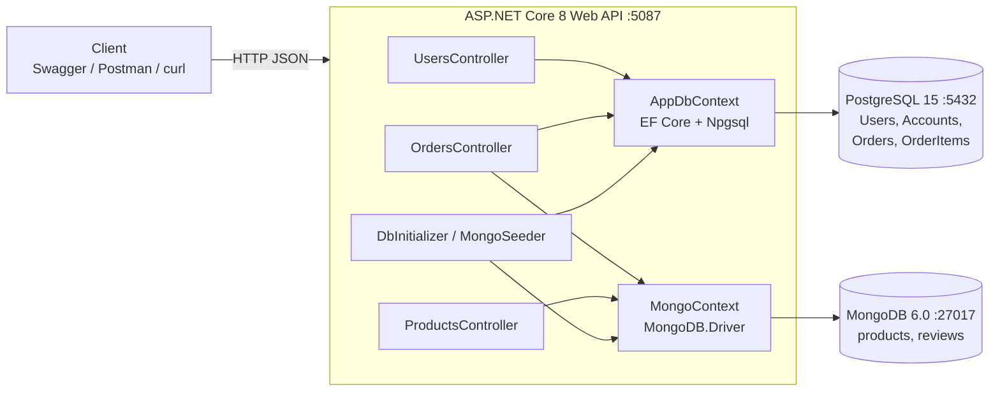
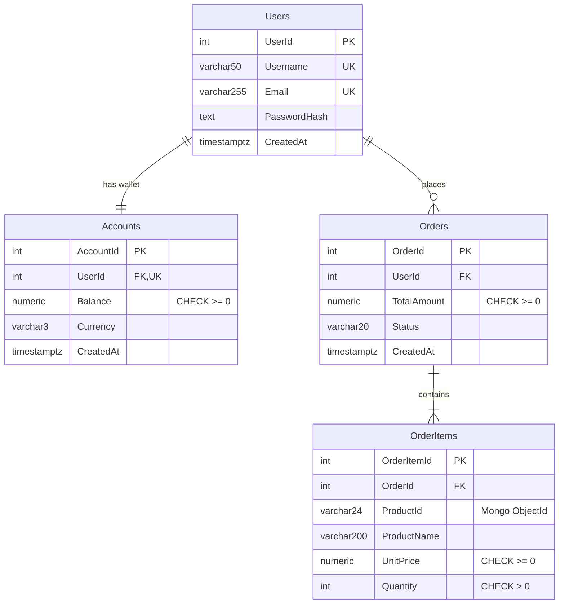
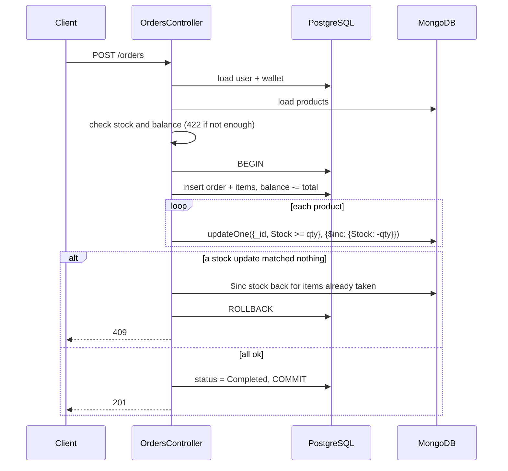

# GAMIQ - Game Marketplace API

269340 Data Centric Application Development (2026) - Team Project Checkpoint 1 + 2

GAMIQ is our backend for a small online game store (kind of like a mini Steam). Users have a
wallet in THB, they can browse games and buy them. We used ASP.NET Core 8 Web API with
PostgreSQL (EF Core) and MongoDB.

Checkpoint 1 (the API and both databases) is the first part of this README. Checkpoint 2 (the
zero-downtime schema migration) starts at [CP2: Zero-downtime schema migration](#cp2-zero-downtime-schema-migration-in-progress).

## Team

| Student ID | Name | CP1 part | CP2 part |
|---|---|---|---|
| 670615021 | Yanisa Khankhumnanta | PostgreSQL | Phase 3 backfill job, backfill verification queries, traffic generator |
| 670615023 | Natthawan Saengsrichan | Docker + MongoDB | Phase 4 switch read, phase 5 contract, fallback video |
| 670615028 | Pitikan Kanjanasiri | API endpoints | Migration phase switch, phase 1 expand, phase 2 dual write |

### Who did what (CP1)

**Natthawan** set up the repo and `docker-compose.yml` (Postgres + Mongo with volumes and
healthchecks), `.env.example`, `.gitignore` and the empty .NET project. Natthawan also did the MongoDB
side: the `Product` and `Review` models, `MongoContext` with the indexes, and `MongoSeeder`
(1,200 games, 2,000 reviews).

**Yanisa** designed the PostgreSQL tables (`Users`, `Accounts`, `Orders`, `OrderItems`) in
`AppDbContext`, including the keys, indexes and check constraints. Yanisa also made the EF Core migration,
exported it to `db/postgres/001_init.sql`, and wrote `DbInitializer` to seed 1,000 users with
wallets and 500 old orders.

**Pitikan** wrote the controllers and DTOs (users, products, orders), the validation, and the
order logic that writes to both databases, plus `GAMIQ.Api.http` and most of this README.

We tested everything together at the end with Swagger and the `.http` file.

## How to run

You need Docker Desktop and the .NET 8 SDK. Make sure nothing else is using ports 5432, 27017
or 5087.

```bash
cp .env.example .env        # default values already match docker-compose
docker compose up -d
docker compose ps           # wait until both say "healthy"

cd src/GAMIQ.Api
dotnet run
```

Then open http://localhost:5087/swagger. You can also use `src/GAMIQ.Api/GAMIQ.Api.http`, which
has a request for every endpoint.

The first run takes a few seconds longer because it creates the tables and seeds both databases.
After that it sees the data is already there and skips seeding. If you want to reset everything:

```bash
docker compose down -v
docker compose up -d
```

## Architecture



Both databases run in Docker with their own named volume, so the data survives a restart.
The `db/postgres` folder is mounted to `/docker-entrypoint-initdb.d`, so Postgres runs our
`001_init.sql` the first time it starts.

## Why we split the data like this

Our rule was simple: anything to do with money goes in PostgreSQL. Wallet balances and orders have
to be correct, so we wanted foreign keys, constraints and real transactions there.

Games are different. A VR game needs a list of headsets, a multiplayer game has max players, and a
PC game has minimum specs. Making a SQL column for every possible field would leave most of them
NULL, so the catalog went into MongoDB. Reviews also went into Mongo because there are a lot of
them and each one can carry different extra info.

## PostgreSQL schema



Some notes on the design:

- Username and email are unique. `Accounts.UserId` is unique too, so each user can only have one wallet.
- Balance can't go negative, and quantity has to be more than 0. These are enforced with CHECK constraints, not only in C#.
- You can't delete a user who has orders (`RESTRICT`). Deleting an order deletes its items (`CASCADE`).
- `OrderItems` keeps its own copy of the product name and price. If a game's price changes later in Mongo, old orders still show what the customer actually paid.
- `Accounts` uses Postgres `xmin` as a row version. If two orders try to change the same wallet at the same time, one of them gets a 409 instead of silently overwriting the other.
- We added indexes on `Orders(UserId, CreatedAt)`, `OrderItems.OrderId` and `OrderItems.ProductId`.

The schema is in the EF migration (`src/GAMIQ.Api/Migrations`) and also as plain SQL in
`db/postgres/001_init.sql`.

## MongoDB collections

`products`: every game has the same basic fields, but `Attributes` changes from game to game.
For example:

```js
{
  "_id": ObjectId("..."),
  "Name": "Neon Requiem: Part II",
  "Description": "Uncover the history of a forgotten kingdom. New maps and modes are added every season.",
  "Price": NumberDecimal("590"),
  "Stock": 197,
  "Genres": ["Simulation", "Adventure"],
  "Platforms": ["Windows", "NintendoSwitch"],
  "Tags": ["VR Supported", "Co-op"],
  "Attributes": {
    "developer": "Pfannerstill and Sons",
    "publisher": "Paucek Group",
    "releaseYear": 2020,
    "ageRating": "T",
    "languages": ["Korean", "German"],
    "maxPlayers": 4,
    "vrHeadsets": ["Meta Quest 3"],
    "estimatedHours": 45,
    "minSpecs": { "os": "Windows 10 64-bit", "ramGb": 8, "storageGb": 60, "gpu": "GTX 1660" }
  },
  "CreatedAt": ISODate("...")
}
```

`reviews`: a rating and comment, plus a `Metadata` object with whatever the client sends
(platform, patch version, and so on). PC reviews also have `avgFps`.

```js
{
  "_id": ObjectId("..."),
  "ProductId": ObjectId("..."),
  "UserId": 900,
  "Rating": 3,
  "Comment": "Fun at first but gets repetitive after a few hours.",
  "PlaytimeHours": 291.9,
  "Metadata": { "platform": "Linux", "patchVersion": "3.10.7", "verifiedPurchase": true, "avgFps": 117 },
  "CreatedAt": ISODate("...")
}
```

The indexes are created when the app starts (`MongoContext.EnsureIndexesAsync`):

- `products`: `CreatedAt`, `Genres`, and a text index on `Name`
- `reviews`: `ProductId + CreatedAt`, and `UserId`

`reviews.UserId` points to a Postgres user and `OrderItems.ProductId` points to a Mongo product.
There's no foreign key across two databases, so the API checks these itself.

## API

Base URL: `http://localhost:5087/api/v1`

| Method | Route | Description | DB |
|---|---|---|---|
| POST | `/users` | create a user (also creates a wallet with 0 THB) | PostgreSQL |
| GET | `/users/{id}` | get a user and their balance | PostgreSQL |
| GET | `/products?page=1&pageSize=20` | catalog with paging, `&genre=RPG` is optional | MongoDB |
| GET | `/products/{id}` | get one game | MongoDB |
| POST | `/products` | add a game, `attributes` can be any JSON | MongoDB |
| POST | `/orders` | buy games (pay from wallet + cut stock) | PostgreSQL + MongoDB |
| GET | `/orders/{id}` | get an order with its items | PostgreSQL |

Status codes we return:

- `200` OK, `201` Created (with a `Location` header)
- `400` for bad input: missing fields, bad email, quantity 0, invalid ObjectId, broken JSON
- `404` when the user, product or order doesn't exist
- `409` when the username or email is already taken, or the stock or wallet changed while ordering
- `422` when there isn't enough stock or money

## How an order works

This was the hardest part, because one order has to update both databases.



Postgres and Mongo can't be in the same transaction. So we open a Postgres transaction, then
reduce stock in Mongo one product at a time. The Mongo update only matches if `Stock >= qty`,
so two people buying the last copy at the same time can't push stock below 0. If any product
fails, we put back the stock we already took and roll back Postgres.

We tested this by sending 10 orders at once for a game with only 3 left. Exactly 3 went through
and stock ended at 0.

One thing we know isn't perfect: if Mongo goes down right in the middle of an order, putting the
stock back could also fail. We think the proper fix is an outbox table or a saga with retries,
but we left that out of CP1.

## Seed data

Seeding runs automatically on startup (`Data/DbInitializer.cs` for Postgres and
`Data/Mongo/MongoSeeder.cs` for Mongo). We used the Bogus library with a fixed seed of 42, so
everyone gets the same data.

- Postgres: 1,000 users, 1,000 wallets, 500 orders and about 990 order items
- Mongo: 1,200 games and 2,000 reviews

Game prices use normal Thai store prices (99, 199, 590, 1,290 THB and so on), and wallets start
with 0 to 5,000 THB. Every seeded user's password is `Passw0rd!`. It's stored as a hash
(ASP.NET Identity `PasswordHasher`), never as plain text.

## Config / secrets

There are no passwords in `appsettings.json`. Connection strings come from `.env`, which is
in `.gitignore`, so only `.env.example` is in git. `Config/DotEnv.cs` loads the file when the app
starts. If you forget to create `.env`, the app stops right away and tells you to copy
`.env.example`.

## CP2: Zero-downtime schema migration (in progress)

**Scenario.** `Orders.TotalAmount` is one number and the currency is not stored anywhere, we just
assumed THB. To sell in other currencies later we replace it with two columns,
`Orders.PriceAmount` + `Orders.CurrencyCode`, using expand-contract, while the API keeps taking
orders.

| # | Phase | What happens | Status |
|---|---|---|---|
| 1 | Expand | `db/postgres/cp2/01_expand.sql` adds the two new columns next to `TotalAmount` | done |
| 2 | Dual write | `POST /orders` writes `TotalAmount` and `PriceAmount` + `CurrencyCode` | done |
| 3 | Backfill | `Jobs/BackfillJob.cs` copies `TotalAmount` into the new columns for old orders, in batches with a checkpoint | done |
| 4 | Switch read | `GET /orders/{id}` reads the new columns | to do |
| 5 | Contract | drop `TotalAmount` | to do |

The traffic generator (`tools/traffic_gen.py`) and the before/after backfill verification queries
(`db/postgres/cp2/verify_backfill.sql`) are done too. Still to do: phase 4, phase 5 and the
fallback video.

### How the API changes phase without a restart

Restarting the API in the middle of the migration would already be downtime, so the phase is a
runtime setting (`Config/MigrationState.cs`). It starts from `Migration:Phase` in
`appsettings.json` (default `Legacy`) and is changed with one request:

```bash
curl -X PUT http://localhost:5087/api/v1/migration/phase -H "Content-Type: application/json" -d '{"phase":"DualWrite"}'
curl http://localhost:5087/api/v1/migration/phase
```

The phases are `Legacy`, `DualWrite`, `ReadNew`, `Contract`.

EF Core puts every mapped column in its SELECT and INSERT, so it would crash on a column that
isn't there yet (before expand) or is already gone (after contract). `AppDbContext` therefore maps
`Orders` differently per phase, and `PhaseModelCacheKeyFactory` makes EF keep one model per phase:

| Phase | `TotalAmount` | `PriceAmount`, `CurrencyCode` |
|---|---|---|
| Legacy | mapped | ignored |
| DualWrite, ReadNew | mapped | mapped |
| Contract | ignored | mapped |

### Running phase 1 and 2

Start the API as usual (it is in `Legacy`), then with traffic running:

```bash
# Phase 1 - expand
docker exec gamiq_postgres psql -U dev_user -d main_db -v ON_ERROR_STOP=1 -f /docker-entrypoint-initdb.d/cp2/01_expand.sql

# Phase 2 - dual write
curl -X PUT http://localhost:5087/api/v1/migration/phase -H "Content-Type: application/json" -d '{"phase":"DualWrite"}'

# check
docker exec gamiq_postgres psql -U dev_user -d main_db -f /docker-entrypoint-initdb.d/cp2/verify_dual_write.sql
```

The order matters: expand first, then dual write. In `DualWrite` the API asks for the new columns,
so they have to exist already.

Why this doesn't block or break anything:

- The new columns are nullable with no default, so Postgres only changes the catalog and does not
  rewrite the table. The `ALTER TABLE` takes a few milliseconds.
- The script sets `lock_timeout = 2s`. If something holds the table, the script fails fast and we
  run it again, instead of making every order wait behind it.
- The new CHECK constraint is added `NOT VALID`, so old rows are not scanned under the lock.
- Old and new values go out in the same `INSERT`, so an order can't have one without the other.
- Seeded orders are left with `NULL` in the new columns on purpose. They are the "old data" for the backfill.

We tested phase 1 and 2 with about 34 requests/second (half `POST /orders`, half `GET /orders/{id}`)
running during the expand script and the switch to dual write: 1,023 requests, no 5xx, p99 164 ms.
After that `verify_dual_write.sql` showed 0 mismatched rows.

### Traffic generator

`tools/traffic_gen.py` keeps sending requests at a fixed rate, half `POST /orders` and half
`GET /orders/{id}` (old seeded orders and orders it just created). We start it first and then run
each migration step while it is going. It only needs Python 3.9 or newer, no `pip install`.

```bash
# once, before the first run: seeded wallets only have 0 - 5,000 THB and would run out
docker exec gamiq_postgres psql -U dev_user -d main_db -f /docker-entrypoint-initdb.d/cp2/demo_topup_wallets.sql

# from the repo root, in a second terminal
python3 tools/traffic_gen.py --rps 20 --seconds 60
python3 tools/traffic_gen.py --seconds 0        # keep going until Ctrl+C
```

It prints one line per second and a summary at the end. The run passes (exit code 0) only when
all three CP2 criteria hold:

| Criteria | How the script checks it |
|---|---|
| 0 HTTP 5xx | counts 5xx answers and requests that got no answer at all |
| 0 data corruption / missing field | every `200` / `201` body must have all order fields, and `totalAmount` must equal the sum of its items |
| p99 below 500 ms | p99 over all requests |

`409` (two orders on the same wallet at the same moment) and `422` (out of stock or money) are
normal answers, they are counted but they are not errors. Other options: `--url`, `--users`,
`--seed-orders`.

We checked that it notices bad data: after changing `TotalAmount` of one order by hand, the reads
of that order were reported as `BAD DATA` and the run failed.

### Running phase 3 (backfill)

The backfill is `src/GAMIQ.Api/Jobs/BackfillJob.cs`. It runs in the background inside the API and
is started with one request. The API has to be in `DualWrite` already, otherwise new orders keep
coming in with empty new columns and the backfill never catches up (the endpoint answers `409` in
`Legacy`). With traffic running:

```bash
# before
docker exec gamiq_postgres psql -U dev_user -d main_db -f /docker-entrypoint-initdb.d/cp2/verify_backfill.sql

# Phase 3 - backfill (returns 202 right away, body is optional)
curl -X POST http://localhost:5087/api/v1/migration/backfill -H "Content-Type: application/json" -d '{"batchSize":100,"delayMs":50}'

# progress, repeat until "state" is "Completed"
curl http://localhost:5087/api/v1/migration/backfill

# after
docker exec gamiq_postgres psql -U dev_user -d main_db -f /docker-entrypoint-initdb.d/cp2/verify_backfill.sql
```

Why this doesn't lock the table or break anything:

- **Batching.** It never runs one big `UPDATE`. Each batch (100 rows by default) is its own short
  transaction, then it pauses (50 ms by default) so the API's own queries get through.
- **Cursor pagination.** Each batch takes the next rows with
  `WHERE "OrderId" > last id AND "PriceAmount" IS NULL ORDER BY "OrderId" LIMIT n`. That is a
  short range scan on the primary key, so it does not get slower further into the table like
  `OFFSET` would.
- **Checkpointing.** The last `OrderId` is saved in the `MigrationCheckpoints` table in the same
  transaction as the batch. If the API stops half way, the next `POST` continues from there. We
  tested it: stopped the API after 150 of 500 rows, started it again, and the log said
  `Backfill started after OrderId 150`.
- It only changes rows where `PriceAmount IS NULL`, so it can't overwrite an order the API has
  already dual-written, and running it again is harmless.
- `lock_timeout = 2s`: if a row is locked by something else it fails fast (`state: Failed`). The
  finished batches stay committed.
- When a pass ends it counts the rows that are still empty. If an order from a `Legacy` request
  slipped in behind the cursor, it does another pass from the start.
- Old orders get `CurrencyCode = 'THB'`, because that was the only currency before.
- At the end it validates `CK_Orders_PriceAmount` (added `NOT VALID` in phase 1). `VALIDATE
  CONSTRAINT` does not block reads or writes.

What `verify_backfill.sql` shows before and after:

| Check | Before | After |
|---|---|---|
| `not_migrated` | number of old orders | 0 |
| `mismatched`, `half_written`, `bad_currency` | 0 | 0 |
| `missing_amount` (`sum(TotalAmount) - sum(PriceAmount)`) | money in the old orders | 0.00 |
| `CK_Orders_PriceAmount` validated | `f` | `t` |

We tested phase 1 to 3 in one run on a fresh database: 20 requests/second for 60 seconds, with the
expand script, the switch to dual write and the backfill all done during those 60 seconds.

- 1,200 requests: 600 `201`, 600 `200`, no 4xx, no 5xx, none failed, no bad data
- p99 over all requests was 70 ms (119 ms for `POST /orders`, 25 ms for `GET /orders/{id}`)
- before the backfill: 735 orders, 654 not migrated (500 seeded + 154 made while the API was still
  in `Legacy`), `missing_amount` 1,192,565.00
- the backfill moved 654 rows in 7 batches
- after: 788 orders, 0 not migrated, 0 mismatched, `legacy_sum` = `new_sum` = 1,289,056.00,
  constraint validated

Starting the backfill a second time changed 0 rows.

### Notes for phase 4 and 5

- **Switch read:** in `OrdersController.ToResponse`, use `PriceAmount` when the phase is `ReadNew` or later.
  Right now the response still reads `TotalAmount` in every phase.
- **Contract:** `TotalAmount` is `NOT NULL`, and in `Contract` the API stops sending it. So the order
  is: `ALTER COLUMN "TotalAmount" DROP NOT NULL`, switch the API to `Contract`, then `DROP COLUMN`.
  `DbInitializer` still seeds `TotalAmount` only and needs the new columns too.
- **Traffic generator:** it checks `totalAmount` in the order response against the items. If
  phase 4 changes the response (for example adds `currencyCode`), keep `totalAmount` or update
  `check_order` in `tools/traffic_gen.py`.
- **Checkpoint table:** the backfill made a small `MigrationCheckpoints` table. It can be dropped together
  with `TotalAmount`.
- The new columns are still nullable. If we want `NOT NULL` on them it should be done the safe way
  (add `CHECK (... IS NOT NULL) NOT VALID`, `VALIDATE`, then `SET NOT NULL`), after the backfill.
- The phase lives in memory of one API process. It goes back to `appsettings.json` on restart.

## Folder structure

```
.
├── docker-compose.yml
├── .env.example
├── db/postgres/001_init.sql
├── db/postgres/cp2/     CP2 migration + verification scripts (run by hand)
├── GAMIQ.slnx
├── tools/traffic_gen.py CP2 traffic generator
└── src/GAMIQ.Api
    ├── Program.cs
    ├── Config/          .env loader
    ├── Controllers/     Users, Products, Orders
    ├── Data/            AppDbContext, DbInitializer, Mongo/ (MongoContext, MongoSeeder)
    ├── Dtos/
    ├── Helpers/         converts JSON attributes so Mongo can save them
    ├── Jobs/            CP2 BackfillJob
    ├── Models/          Postgres/ and Mongo/
    ├── Migrations/
    └── GAMIQ.Api.http
```

## Problems we ran into

- **`ConnectionStrings:Postgres is not set`**: you haven't created `.env` yet. Run `cp .env.example .env`.
- **Connection refused when starting the API**: Docker isn't ready yet. Wait for `healthy` in `docker compose ps`, then run it again.
- **Port 5432 or 27017 already in use**: stop your local Postgres/Mongo, or change the port in `docker-compose.yml`.
- **Data looks half seeded**: run `docker compose down -v`, then `docker compose up -d`.
- **Only a newer .NET is installed**: that's fine. The csproj has `RollForward` set, so it still runs.
